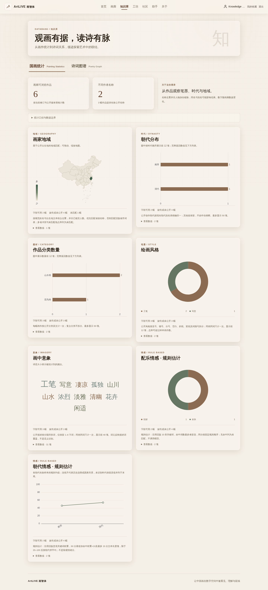
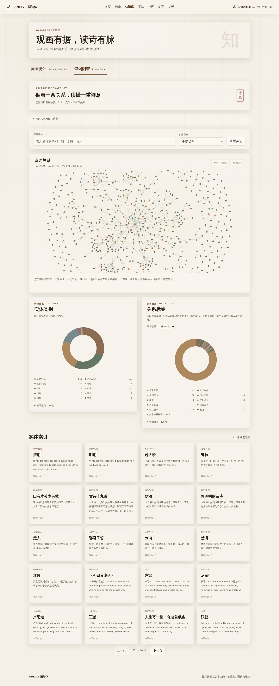

# Knowledge isolated validation evidence

Application source reviewed: `a5e5c50b48c046eb5972c0d614fc932c8f3036b6` (Web) with
`a6875b63fafd4c8658d79f6ec040d08b7cad04ad` (Core). Subsequent release-preparation
commits only add documentation, review images and offline asset-verification
support; they do not change the application or rebuild the running preview.

Validated on 2026-10-12 with Node.js 22, Java 17 and isolated PostgreSQL 16.15.
Web BUILD_ID: `ZTBFk3sN5MNNwckmM-GNR`. Core JAR SHA-256:
`550d1bb9e71717226d5fc7645c94b6cb21234ecbfff44aa3fdae4f1f9c1a84d8`.

## Scope and observed results

- `npm run typecheck`, `npm run lint`, `npm test` (83 tests) and `npm run build`
  completed successfully. Session-generation and media JSON error regressions
  are included in the unit suite.
- Core `mvn -B -ntp clean package` ran 24 tests without failures or skips in the
  explicitly configured local fixture environment, including seven PostgreSQL
  tests. CI without that environment will skip those seven PG tests.
- Actual isolated UI/API desktop and 390px layouts rendered both views with no
  JavaScript/console errors or horizontal overflow. The preview's painting
  population is **six eligible synthetic paintings**, not production data.
- The graph view used the inherited real snapshot: **711 unique nodes / 609
  edges**. The map used the inherited 35-feature snapshot. Neither JSON artifact
  is in this repository. Screenshots document isolated review, not production
  distribution approval. Map source/redistribution rights remain a release gate;
  see the associated Core PR's `docs/knowledge-map-provenance.md`.
- Existing browser evidence covers search, pagination, one-hop focus, node/edge
  detail, missing-file/retry, empty/restricted painting data, empty graph,
  untrusted text, late 401 and media JSON 404. Injected failures were identified
  as fixtures, not actual production incidents.
- The 406-category relation donut was checked against real Canvas pixels after
  removing its minimum sector angle; count proportions were preserved.
- Separate Core scale validation used 10,000 deterministic synthetic paintings,
  10,200 source memberships and 266,000 annotation rows. Exact eligible total
  7,000, author-name total 50 and all seven metric distributions matched.
  Actual HTTP completed 33 assertions with a 3,014-byte response. The following
  five requests had median 1,584.907 ms (range 1,520.626–1,807.920 ms): loopback,
  warm cache, one concurrent request, connection-level JIT off, minimal read
  tables/relevant indexes. This is not production performance acceptance.

Prior unaffected browser/state and deployment-fixture evidence was reused;
checks were not all repeated after documentation-only commits. CI/review status
belongs to the associated PR checks, not this dated local evidence.

## Screenshots

These are rendered review images, not runtime JSON/data bundles. No credentials,
production records, private annotations or real user uploads appear in them.

| View | Desktop | Narrow (390px) |
| --- | --- | --- |
| Painting statistics | [Open](knowledge-review/painting-desktop.png) | [Open](knowledge-review/painting-mobile.png) |
| Poetry graph | [Open](knowledge-review/poetry-desktop.png) | [Open](knowledge-review/poetry-mobile.png) |

## Remaining release acceptance

Production field coverage, real permission combinations, concurrent capacity,
coordinated release/recovery and map redistribution permission remain unverified.
Core must first gain an approved business-upgrade path; the current equivalent
repackaging publisher cannot carry new endpoints. Publish compatible Core and
external assets before Web through c5ea/R25 coordination. Missing APIs/assets
produce Knowledge unavailable/retry states. Roll back code without restoring the
database or removing existing data/media/huaniao records.
